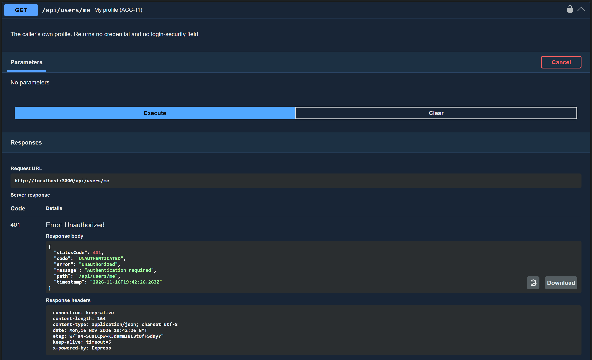
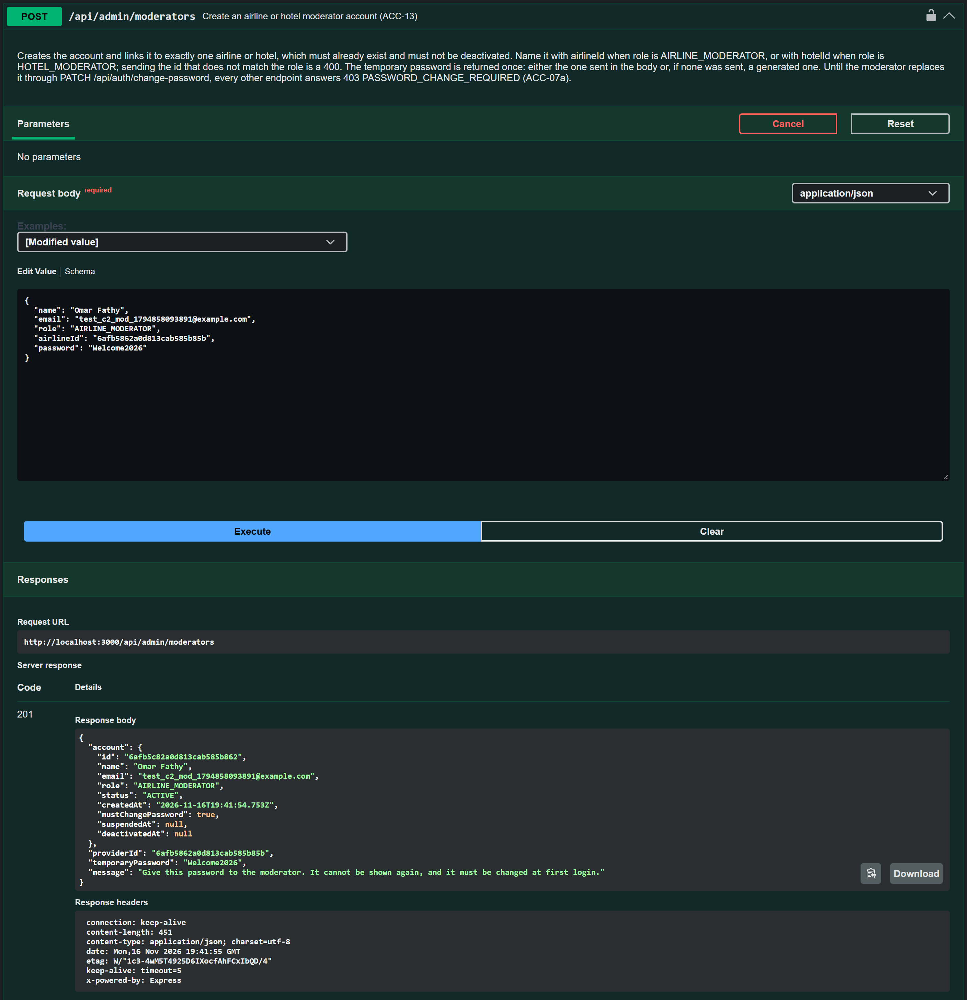
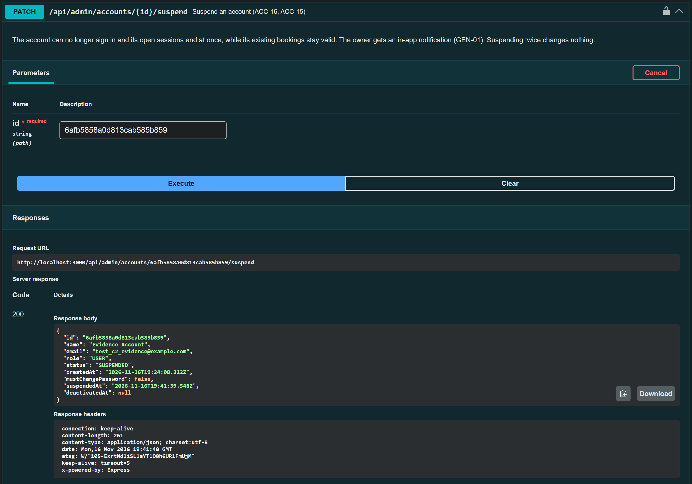
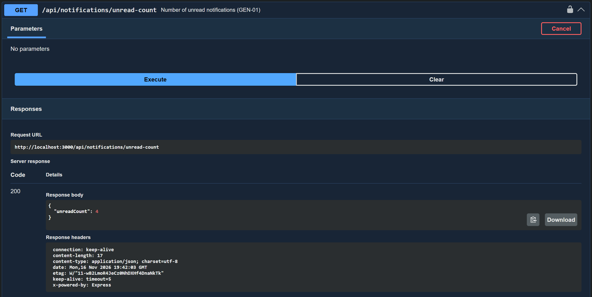
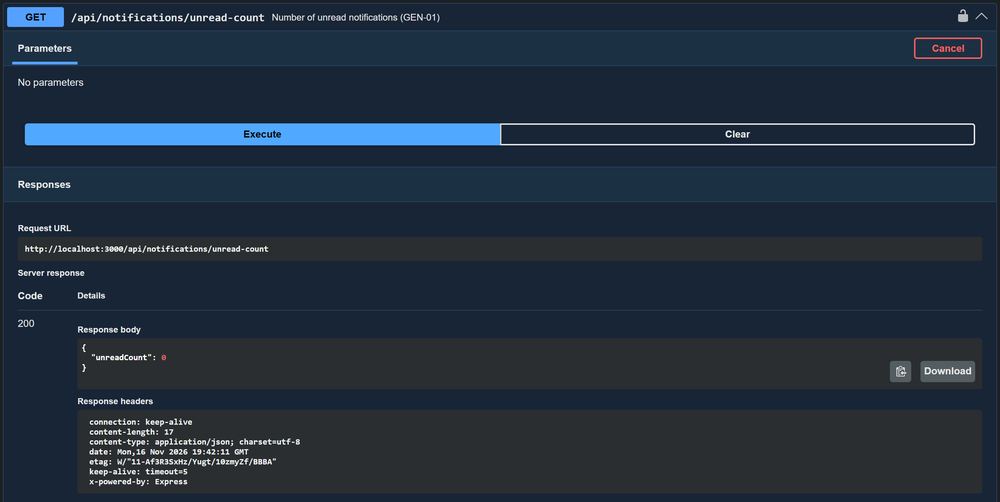

# Swagger UI evidence — C2 (accounts, notifications, payments)

Screenshots of every endpoint C2 owns, taken in Swagger UI at
`http://localhost:3000/api/docs` against the shared MongoDB Atlas cluster.
Each one shows the endpoint, the request body or parameters, the **Request
URL**, the response **code** and the response **body**.

This folder grows over time. The seven payment and policy endpoints that are
not pictured yet are listed under ["Still to capture"](#still-to-capture), with
what each one needs before it can be.

`CAPTURE-RUN.md` is the run that produced these, in the order that works: each
step only needs state an earlier step created, and the sign-ins are grouped so
the session cookie is never replaced mid-group. Following it by hand gives the
same shots; this set was taken by driving the same page in Chrome, so the run
can be repeated exactly when an endpoint changes. Every request is a real one
against the running server - the responses are whatever the API actually
returned. Re-capturing overwrites the same filename, so this folder never holds
two versions of one shot.

## What is here

16 screenshots covering the 12 endpoints that work end to end today.

| Requirement | Endpoint | Shows | File |
| --- | --- | --- | --- |
| ACC-14 | `GET /api/admin/accounts` | `200` + the page of accounts | `01_ACC-14_list-accounts_200.png` |
| ACC-16 | `PATCH /api/admin/accounts/{id}/suspend` | `200`, `status: SUSPENDED` | `02_ACC-16_suspend_200.png` |
| ACC-16 | `PATCH /api/admin/accounts/{id}/reactivate` | `200`, `status: ACTIVE` | `03_ACC-16_reactivate_200.png` |
| ACC-07a | `POST /api/admin/users/{id}/reset-password` | `200` + the one-time temporary password | `04_ACC-07a_reset-password_200.png` |
| ACC-13 | `POST /api/admin/moderators` | `201` + the account, its provider and its temporary password | `05_ACC-13_create-moderator_201.png` |
| ACC-07a | any route, on a temporary password | `403 PASSWORD_CHANGE_REQUIRED` | `06_ACC-07a_password-change-required_403.png` |
| ACC-08 | `PATCH /api/auth/change-password` | `200`, and the lockout above is over | `07_ACC-08_change-password_200.png` |
| GEN-01 | `GET /api/notifications/unread-count` | `200`, `unreadCount: 4` | `08_GEN-01_unread-count_200_four-unread.png` |
| GEN-01 | `GET /api/notifications?page=1&unreadOnly=true` | `200`, the unread ones, newest first | `09_GEN-01_list-notifications_200.png` |
| GEN-01 | `PATCH /api/notifications/{id}/read` | `204` | `10_GEN-01_mark-one-read_204.png` |
| GEN-01 | `GET /api/notifications/unread-count` | `200`, `unreadCount: 3` — the 204 above did something | `11_GEN-01_unread-count_200_three-unread.png` |
| GEN-01 | `PATCH /api/notifications/read-all` | `204` | `12_GEN-01_mark-all-read_204.png` |
| GEN-01 | `GET /api/notifications/unread-count` | `200`, `unreadCount: 0` | `13_GEN-01_unread-count_200_none-unread.png` |
| ACC-09 | `PATCH /api/users/me` | `200`, name, phone and currency changed | `14_ACC-09_update-profile_200.png` |
| ACC-12 | `DELETE /api/users/me` | `200`, `status: DEACTIVATED`, the row kept | `15_ACC-12_deactivate_200.png` |
| ACC-12 | `GET /api/users/me` after it | `401` — the cookie died with the account | `16_ACC-12_cookie-revoked_401.png` |

## ACC-07a — admin resets an account to a temporary password

The password is shown once and stored only as a bcrypt hash. The account then
owes a password change and can reach nothing else until it sets its own.

## ACC-08 — change your own password

The current password is required, and the new one goes through the shared
password rules. This is also the way out of the 403 above.

## ACC-09 — edit your own profile

Name, phone and preferred currency. The currency must be one of the seeded
ones; `email`, `role` and `status` are refused as unknown fields.

## ACC-12 — deactivate your own account

Needs `confirm: true` in the body. Nothing is deleted: the response still
carries the account's id, name and email, and only `status` has changed, so past
bookings, payments and refunds keep pointing at a real account. The row also
records a `deactivatedAt`, which is kept for the admin list (ACC-14) and is not
part of this response — the shot shows `status: DEACTIVATED`, not that field.

The session stops working at once for two reasons: the guard reloads the account
on every request, and since ACC-06 deactivation also revokes every session the
account had, which is what stops its refresh token as well.

## ACC-13 — admin creates a provider moderator

The account is created and linked to exactly one airline, with a temporary
password it must replace at first login. The provider is named by role:
`airlineId` for an `AIRLINE_MODERATOR`.

## ACC-14 — list every account

Paginated, searchable and filterable by role and status.

## ACC-16 — suspend and reactivate an account

Suspending notifies the owner (ACC-15) and stops its session working;
reactivating puts the status back. Bookings are untouched.

## GEN-01 — in-app notifications

The notices came from the suspensions above (only suspending notifies, not
reactivating). The count starts at **4** rather than 2 because this account had
also been suspended during an earlier capture run and those notices were still
unread — the number is whatever the account has, and nothing here depends on it
being a particular value.

What matters is the shape. The two `PATCH` routes answer `204` with an empty
body by design, so the proof that they worked is the count before and after:
**4**, then **3** after one is marked read, then **0** after mark-all-read.

## Still to capture

**These are no longer blocked.** They were waiting on a `BookingsPort`, and both
booking modules provide one now: `FlightBookingsModule` exports
`FLIGHT_BOOKINGS_PORT` and `HotelBookingsModule` exports `HOTEL_BOOKINGS_PORT`,
each from a `@Global()` module so `BookingsGateway` can see it. The
`501 BOOKING_TYPE_UNAVAILABLE` these used to answer is gone: ask for a booking
that does not exist and the answer is now `404`, the same one a booking
belonging to somebody else gets.

What they still need is a **real booking on hold** to act on, which is several
requests through another module first — a hotel, a room, availability and a
hold for the hotel side, or a flight and a seat hold for the flight side. That
is the next addition to this folder.

| Requirement | Endpoint | Needs |
| --- | --- | --- |
| PAY-02 | `GET /api/bookings/{type}/{id}/policies` | a booking on hold |
| PAY-02 | `POST /api/bookings/{type}/{id}/accept-policies` | the same, plus its `policyVersion` |
| PAY-01 | `POST /api/payments` | the same, with the policies accepted |
| PAY-01 | `POST /api/payments/{id}/retry` | a payment of your own, so the one above first |
| PAY-01 | `GET /api/payments/{id}` | the same |
| PAY-03 | `GET /api/refunds/{id}` | a refund, so a confirmed booking that is then cancelled |
| PAY-01 | `POST /api/payments/webhook` | nothing from Swagger: Stripe signs it and the signature is checked against the raw request bytes, so a "Try it out" can only fail. It is proved with the Stripe CLI (`docs/api/POSTMAN.md` §6) |

Meanwhile the payment flow is covered by `backend/test/payments.e2e-spec.ts`,
`refunds.e2e-spec.ts` and `booking-policies.e2e-spec.ts`, which drive it against
a mocked port, and the Postman collection checks that the gateway really does
see both ports — if a module ever stops being `@Global()`, those requests go
back to answering 501 and fail.

## Note on the screenshots

The `curl` preview is cropped out of every shot. It repeats the request body,
which after an admin sign-in contains `ADMIN_PASSWORD` in plain text. The
temporary passwords visible in the ACC-07a and ACC-13 responses belong to
throwaway `test_c2_*` accounts created for these captures and deleted
afterwards.
